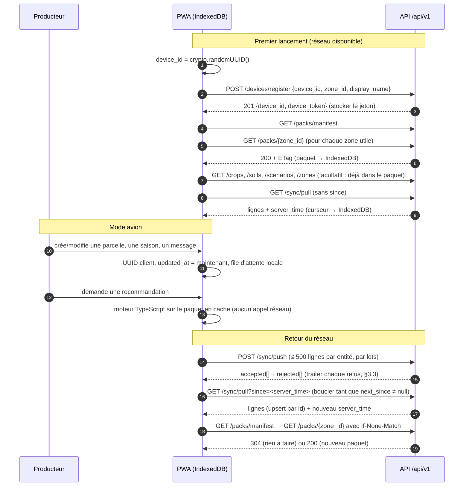

# API Field Shift Togo — guide du développeur frontend

Ce document suffit pour brancher la PWA et réimplémenter le moteur en TypeScript, sans lire le code Python.
Types TypeScript prêts à l'emploi : [`docs/api-types.ts`](api-types.ts).

Tous les exemples ont été obtenus en appelant l'API **en production** le 2026-11-08. Les données de test ont ensuite été supprimées de la base.
Les longues listes sont raccourcies avec `…` ; rien d'autre n'est modifié, sauf les jetons d'appareil, qui sont raccourcis.

## Sommaire

1. [Vue d'ensemble](#1-vue-densemble)
2. [Endpoints](#2-endpoints)
3. [Règles à respecter](#3-règles-à-respecter)
4. [Le paquet de zone et le moteur](#4-le-paquet-de-zone-et-le-moteur)
5. [Affichage obligatoire](#5-affichage-obligatoire)
6. [Changements de contrat du 2026-11-08](#6-changements-de-contrat-du-2026-11-08)
7. [Types TypeScript](#7-types-typescript)

---

## 1. Vue d'ensemble

| | |
|---|---|
| URL de base | **`https://agri-shift-api.fastapicloud.dev/api/v1`** |
| Documentation interactive | https://agri-shift-api.fastapicloud.dev/docs (Swagger), schéma brut : `/openapi.json` |
| Format | JSON UTF-8, réponses compressées en gzip au-delà de 1 000 octets |
| Dates | ISO 8601 en UTC avec `Z` (`"2026-11-08T18:44:08.043904Z"`) ; dates de semis `"YYYY-MM-DD"` |
| Identifiants | UUID générés **par le client** pour l'appareil et pour chaque ligne qu'il crée |

> ⚠️ Le schéma `/openapi.json` est incomplet sur trois points. Ce document et `api-types.ts` font foi :
> - les erreurs 422 y sont décrites au format FastAPI (`{"detail": …}`), alors que l'API renvoie toujours `{"error": …}` (§3.5) ;
> - `X-Device-Token` y apparaît comme facultatif, alors qu'il est obligatoire sur les routes protégées ;
> - plusieurs réponses n'y sont pas typées (health, summary, posts, lignes synchronisées, paquet).

### Le principe du hors ligne

1. **Les paquets de zone** (`/packs/{zone_id}`, environ 12 Ko chacun) contiennent tout ce qu'il faut pour calculer : climat décadaire NASA POWER, cultures, sols, règles, scénarios, barème. Téléchargez-les dès qu'il y a du réseau, gardez-les dans **IndexedDB**, et **calculez sur le téléphone** avec le moteur TypeScript (§4).
2. **`/simulate` et `/rotation/*` ne servent qu'en ligne** : pour une démo, pour vérifier, ou en secours tant que le moteur TypeScript n'est pas prêt. Ils renvoient exactement les mêmes résultats que le moteur de référence (`golden_cases.json`).
3. **Les données du producteur** (parcelles, saisons, messages) sont créées hors ligne, en local, puis **envoyées avec `POST /sync/push`** et **récupérées avec `GET /sync/pull`** au retour du réseau. C'est le local qui fait foi : la dernière écriture gagne.

### Parcours type



---

## 2. Endpoints

Légende : 🔓 public, sans jeton. 🔑 en-tête `X-Device-Token: <device_token>` obligatoire.

**Limite de débit** : 60 requêtes par minute (fenêtre glissante).
- Elle est comptée **par appareil** sur toutes les routes 🔑.
- Sur `POST /devices/register`, elle est comptée **par adresse IP**.
- Les autres routes 🔓 n'ont pas de limite.
- Au-delà de la limite, l'API répond `429 rate_limited` : attendez une minute.

Vérifié en production avec 70 pulls simultanés : 60 réponses 200, puis 10 réponses 429 :

```json
{"error": {"code": "rate_limited", "message_fr": "Trop de requêtes, réessayez dans une minute."}}
```

Toute route peut aussi renvoyer `500 internal_error`. Toutes les erreurs ont le format du §3.5.

### Tableau récapitulatif

| # | Méthode | Chemin | Accès | Codes |
|---|---|---|---|---|
| 1 | GET | `/health` | 🔓 | 200 |
| 2 | GET | `/zones` | 🔓 | 200 |
| 3 | GET | `/zones/{zone_id}/summary` | 🔓 | 200, 404 |
| 4 | GET | `/crops` | 🔓 | 200 |
| 5 | GET | `/soils` | 🔓 | 200 |
| 6 | GET | `/scenarios` | 🔓 | 200 |
| 7 | GET | `/packs/manifest` | 🔓 | 200 |
| 8 | GET | `/packs/{zone_id}` | 🔓 | 200, 304, 404 |
| 9 | POST | `/devices/register` | 🔓 (limite par IP) | 201, 400, 409, 422, 429 |
| 10 | PATCH | `/devices/me` | 🔑 | 200, 400, 401, 422, 429 |
| 11 | POST | `/sync/push` | 🔑 | 200, 401, 422, 429 |
| 12 | GET | `/sync/pull` | 🔑 | 200, 401, 422, 429 |
| 13 | GET | `/posts` | 🔓 | 200, 404, 422 |
| 14 | POST | `/posts` | 🔑 | 201, 400, 401, 409, 422, 429 |
| 15 | DELETE | `/posts/{post_id}` | 🔑 | 200, 401, 403, 404, 422, 429 |
| 16 | POST | `/simulate` | 🔓 | 200, 400, 404, 422 |
| 17 | POST | `/rotation/recommend` | 🔓 | 200, 400, 404, 422 |
| 18 | POST | `/rotation/compare-scenarios` | 🔓 | 200, 400, 404, 422 |

---

### 2.1 `GET /health` 🔓

État du service. Aucun paramètre. Réponse `200` (`HealthResponse`) ; `status` vaut `"degraded"` et `db` vaut `"error"` si la base est injoignable.

```json
{"status": "ok", "db": "ok", "packs_count": 3, "version": "0.1.0"}
```

### 2.2 `GET /zones` 🔓

Liste des zones, chacune **au format `zone` du paquet** (dates de semis calculées). Réponse `200` : `PackZone[]`, dans l'ordre `maritime_lome`, `plateaux_kpalime`, `kara_kara`.

```json
[
  {
    "zone_id": "maritime_lome",
    "name_fr": "Maritime",
    "region": "Maritime",
    "latitude": 6.1725,
    "longitude": 1.2314,
    "elevation_m": 14.66,
    "seasons": [
      {"season_id": "main", "label_fr": "Grande saison", "sowing_dekad": 8, "sowing_source": "computed", "provisional_sowing_dekad": 10, "onset_dekad_clim": 8},
      {"season_id": "second", "label_fr": "Petite saison", "sowing_dekad": 24, "sowing_source": "computed", "provisional_sowing_dekad": 25, "onset_dekad_clim": 24}
    ],
    "coordinate_note": "Point de référence approximatif (Lomé) ; pas une parcelle agricole."
  },
  …,
  {
    "zone_id": "kara_kara",
    "name_fr": "Kara",
    "region": "Kara",
    "latitude": 9.5511,
    "longitude": 1.1861,
    "elevation_m": 402.31,
    "seasons": [
      {"season_id": "main", "label_fr": "Saison des pluies", "sowing_dekad": 13, "sowing_source": "computed", "provisional_sowing_dekad": 16, "onset_dekad_clim": 13}
    ],
    "coordinate_note": "Point de référence approximatif (Kara) ; pas une parcelle agricole."
  }
]
```

### 2.3 `GET /zones/{zone_id}/summary` 🔓

Synthèse publique d'une zone, pour la page « Générale » : chiffres climatiques clés, agrégats **anonymes** des producteurs et 20 derniers messages.
- Une culture n'apparaît que si **au moins 3 parcelles distinctes** l'ont déclarée pour un `season_label` ; sinon elle est comptée dans `{"crop_id": "other", "name_fr": "autres"}`.
- Les parcelles de démonstration ne sont jamais comptées.
- `climate` vaut `null` si la zone n'a pas de paquet.

| Code | Cas |
|---|---|
| 200 | `ZoneSummaryResponse` |
| 404 | `unknown_zone` : `{"error": {"code": "unknown_zone", "message_fr": "Zone inconnue : atlantis"}}` |

```json
{
  "zone_id": "kara_kara",
  "name_fr": "Kara",
  "region": "Kara",
  "climate": {
    "source_type": "nasa_power",
    "source_name": "NASA POWER daily point (community AG)",
    "baseline_period": "1991-2020",
    "annual_p_mm": 1148.18,
    "annual_et0_mm": 1709.17,
    "mean_tmean_c": 25.97,
    "wettest_dekad": {"dekad": 24, "label_fr": "août D3", "p_mm": 80.41},
    "trend": {"baseline_period": "1991-2020", "recent_period": "2016-2025", "p_change_pct": -1.17, "t_change_c": 0.33, "note_fr": "Constat historique, pas une prévision."},
    "warnings_fr": [
      "Réanalyse sur une maille de ~50 km : pas une mesure de votre champ.",
      "Source : NASA POWER (réanalyse/modèle), normales décadaires 1991-2020."
    ],
    "seasons": [
      {"season_id": "main", "label_fr": "Saison des pluies", "sowing_dekad": 13, "sowing_source": "computed", "provisional_sowing_dekad": 16, "onset_dekad_clim": 13}
    ]
  },
  "producers": {
    "n_plots": 1,
    "anonymity_threshold": 3,
    "crops_by_season": [
      {"season_label": "2026-main", "crops": [{"crop_id": "other", "name_fr": "autres", "n_plots": 1}]}
    ],
    "note_fr": "Déclarations anonymes des producteurs de la zone ; une culture n'apparaît que si au moins 3 parcelles l'ont déclarée, sinon elle est comptée dans « autres ». Les parcelles de démonstration ne sont pas comptées."
  },
  "recent_posts": [
    {"id": "a3ef7c74-97cf-48b3-844c-73543c8960de", "zone_id": "kara_kara", "body": "Qui a des semences de niébé ?", "updated_at": "2026-11-08T18:44:19.231876Z", "deleted": false, "server_updated_at": "2026-11-08T18:44:19.231876Z", "author_name": null},
    {"id": "95848f21-2b63-490c-a723-9c01a7817d7f", "zone_id": "kara_kara", "body": "Les pluies arrivent en retard cette année ?", "updated_at": "2026-11-08T09:30:00Z", "deleted": false, "server_updated_at": "2026-11-08T18:44:08.043929Z", "author_name": "Kossi K. (test doc)"}
  ]
}
```

`crops_by_season` est trié par `season_label` décroissant. Dans chaque saison, les cultures visibles sont triées par nombre de parcelles décroissant, puis par `crop_id`, et `other` vient en dernier.

### 2.4 `GET /crops`, 2.5 `GET /soils`, 2.6 `GET /scenarios` 🔓

Référentiels. Leur contenu est **identique** à celui des paquets, donc inutile de les appeler si les paquets sont en cache. Réponses `200` : `Crop[]` (5 cultures), `Soil[]` (4 sols), `Scenario[]` (7 scénarios).

```json
[
  {
    "crop_id": "maize", "name_fr": "Maïs", "family": "Poaceae", "n_fixing": false, "cycle_days": 100,
    "water_need": "medium_high", "drought_tolerance": "low_medium", "food_staple": true,
    "kc_ini": 0.3, "kc_mid": 1.2, "kc_end": 0.6, "root_depth_m": 1.0, "depletion_p": 0.55,
    "phases": {"initial": 0.2, "development": 0.3, "mid": 0.3, "late": 0.2},
    "source_type": "provisional_demo",
    "source_note": "Cycle et classes repris du pack AGRI SHIFT (cultures.json). Kc, profondeur racinaire et fraction p : ordre de grandeur inspiré de FAO-56, à valider par un agronome."
  },
  …
]
```

```json
[
  {"soil_id": "sandy", "label_fr": "Sableux", "taw_mm_per_m": 70.0, "source_type": "provisional_demo", "source_note": "Réserve utile : ordre de grandeur inspiré de FAO-56, à valider par un agronome."},
  {"soil_id": "sandy_loam", "label_fr": "Sablo-limoneux", "taw_mm_per_m": 110.0, "source_type": "provisional_demo", "source_note": "Réserve utile : ordre de grandeur inspiré de FAO-56, à valider par un agronome."},
  …
]
```

```json
[
  {"scenario_id": "baseline", "label_fr": "Référence (climat moyen)", "rainfall_change_pct": 0.0, "temperature_change_c": 0.0, "source_type": "synthetic_scenario", "note_fr": "Stress-test hypothétique, pas une prévision."},
  {"scenario_id": "dry_minus10", "label_fr": "Pluie −10 %", "rainfall_change_pct": -10.0, "temperature_change_c": 0.0, "source_type": "synthetic_scenario", "note_fr": "Stress-test hypothétique, pas une prévision."},
  …
]
```

Identifiants actuels :
- cultures : `maize`, `sorghum`, `rice`, `groundnut`, `cowpea` ;
- sols : `sandy`, `sandy_loam`, `loam`, `clay` ;
- scénarios : `baseline`, `dry_minus10`, `dry_minus20`, `dry_minus30`, `hot_plus1`, `hot_plus2`, `dry_hot`.

### 2.7 `GET /packs/manifest` 🔓

Liste des paquets disponibles. Réponse `200` : `ManifestEntry[]`.
- `sha256` est l'empreinte du fichier, c'est-à-dire l'ETag sans les guillemets.
- `url` est relative à l'hôte de l'API.

```json
[
  {"zone_id": "kara_kara", "pack_version": "2026.11.04-3", "sha256": "9d37a0cc0daefdd7330db11331e15de5847c0feb86e35a28fcd2bf4cdba9daa7", "size_bytes": 12226, "url": "/api/v1/packs/kara_kara"},
  {"zone_id": "maritime_lome", "pack_version": "2026.11.04-3", "sha256": "e06eaf53abac463b4d01ed2214ed6544df672e19239a2efc2985e6e740c7fa09", "size_bytes": 12388, "url": "/api/v1/packs/maritime_lome"},
  …
]
```

### 2.8 `GET /packs/{zone_id}` 🔓

Le paquet de zone (`ZonePack`, §4). En-tête de requête facultatif : `If-None-Match: "<sha256>"`.

| Code | Cas |
|---|---|
| 200 | Paquet JSON. En-têtes : `ETag: "<sha256>"`, `Cache-Control: public, max-age=3600` |
| 304 | `If-None-Match` correspond : corps vide, mêmes en-têtes |
| 404 | `{"error": {"code": "unknown_zone", "message_fr": "Zone inconnue ou paquet absent : atlantis"}}` |

En-têtes réels de la réponse 200 (12 226 octets décompressés, 3 081 octets en gzip) :

```
etag: "9d37a0cc0daefdd7330db11331e15de5847c0feb86e35a28fcd2bf4cdba9daa7"
cache-control: public, max-age=3600
content-type: application/json
```

Corps de la réponse (clés triées, JSON compact sur une ligne, reformaté ici) :

```json
{
  "climate": {
    "baseline_period": "1991-2020",
    "dekads": [
      {"dekad": 1, "et0_mm": 58.49, "label_fr": "janv. D1", "p_cv": null, "p_mm": 0.67, "p_p20": 0.0, "tmean_c": 24.07},
      {"dekad": 2, "et0_mm": 59.08, "label_fr": "janv. D2", "p_cv": 2.8, "p_mm": 1.54, "p_p20": 0.0, "tmean_c": 24.89},
      …
    ],
    "source_name": "NASA POWER daily point (community AG)",
    "source_type": "nasa_power",
    "trend": {"baseline_period": "1991-2020", "note_fr": "Constat historique, pas une prévision.", "p_change_pct": -1.17, "recent_period": "2016-2025", "t_change_c": 0.33},
    "units": {"et0_mm": "mm/décade", "p_mm": "mm/décade", "tmean_c": "°C"},
    "warnings_fr": ["Réanalyse sur une maille de ~50 km : pas une mesure de votre champ.", "Source : NASA POWER (réanalyse/modèle), normales décadaires 1991-2020."]
  },
  "crops": […],
  "data_provenance": [
    {"item": "climate", "source_type": "nasa_power"}, {"item": "crops", "source_type": "provisional_demo"},
    {"item": "soils", "source_type": "provisional_demo"}, {"item": "rules", "source_type": "provisional_demo"},
    {"item": "scoring", "source_type": "provisional_demo"}, {"item": "sowing_calendar", "source_type": "computed"},
    {"item": "scenarios", "source_type": "synthetic_scenario"}
  ],
  "generated_at": "2026-11-04T17:20:05Z",
  "pack_version": "2026.11.04-3",
  "rules": [
    {"all": [{"field": "prev.family", "op": "eq", "value": "Fabaceae"}, {"field": "next.family", "op": "eq", "value": "Poaceae"}],
     "delta": 10.0, "effect": "bonus", "explanation_fr": "Une légumineuse avant une céréale enrichit le sol en azote.", "rule_id": "R001",
     "source_note": "Reprise de R001 du pack AGRI SHIFT, au format structuré. Score logiciel, à valider par un agronome.", "source_type": "provisional_demo"},
    …
  ],
  "scenarios": […],
  "schema_version": 1,
  "scoring": {
    "drought_levels": {"high": 4.0, "low": 0.0, "low_medium": 1.0, "medium": 2.0, "medium_high": 3.0},
    "et0_temp_sensitivity_per_c": 0.03, "horizon_default": 3, "horizon_max": 4, "initial_soil_water_fraction": 0.5,
    "phase_weights": {"development": 1.0, "initial": 0.5, "late": 0.5, "mid": 2.0},
    "priority_bonus": {"balanced": {"drought_level_factor": 1.0, "food_staple": 2.5}, "drought_resilience": {"drought_level_factor": 2.0, "food_staple": 0.0}, "food_security": {"drought_level_factor": 0.0, "food_staple": 5.0}},
    "season_resilience_base": {"balanced": 25.0, "drought_resilience": 30.0, "food_security": 20.0},
    "source_type": "provisional_demo", "top_n": 3
  },
  "soils": […],
  "zone": {"coordinate_note": "Point de référence approximatif (Kara) ; pas une parcelle agricole.", "elevation_m": 402.31, "latitude": 9.5511, "longitude": 1.1861, "name_fr": "Kara", "region": "Kara", "seasons": [{"label_fr": "Saison des pluies", "onset_dekad_clim": 13, "provisional_sowing_dekad": 16, "season_id": "main", "sowing_dekad": 13, "sowing_source": "computed"}], "zone_id": "kara_kara"}
}
```

### 2.9 `POST /devices/register` 🔓 (limite par IP)

Crée l'identité de l'appareil, sans compte utilisateur.

| Champ | Type | Obligatoire | Contraintes |
|---|---|---|---|
| `device_id` | UUID | oui | généré par le client (`crypto.randomUUID()`) |
| `display_name` | string \| null | non | ≤ 128 caractères ; espaces de début et de fin retirés ; **public** (affiché comme auteur des messages) |
| `zone_id` | string \| null | non | zone connue ; détermine les messages reçus par `pull` |
| `priority` | `food_security` \| `drought_resilience` \| `balanced` \| null | non | |

| Code | Cas |
|---|---|
| 201 | `{device_id, device_token}` : le jeton n'est donné **qu'une seule fois** |
| 400 | `unknown_zone` |
| 409 | `device_exists` : cet UUID est déjà enregistré (§3.2) |
| 422 | `validation_error` (UUID invalide, nom trop long…) |
| 429 | `rate_limited` |

```http
POST /api/v1/devices/register
{"device_id": "3ba0ae43-d4f8-4a7a-87bb-c12f23d70262", "display_name": "Kossi (test doc)", "zone_id": "kara_kara", "priority": "drought_resilience"}
```
```json
201 {"device_id": "3ba0ae43-d4f8-4a7a-87bb-c12f23d70262", "device_token": "s2xphOpv5UaX…(43 caractères, raccourci ici)"}
409 {"error": {"code": "device_exists", "message_fr": "Cet appareil est déjà enregistré."}}
400 {"error": {"code": "unknown_zone", "message_fr": "Zone inconnue : mars"}}
422 {"error": {"code": "validation_error", "message_fr": "Données invalides.", "details": [{"loc": ["body", "device_id"], "msg": "Input should be a valid UUID, invalid character: found `n` at 0"}]}}
```

### 2.10 `PATCH /devices/me` 🔑

Met à jour le profil. Seuls les champs **présents** dans le corps sont modifiés ; `null` efface la valeur. Les champs et contraintes sont ceux de `register`, sans `device_id`.

| Code | Cas |
|---|---|
| 200 | `DeviceProfile` |
| 400 | `unknown_zone` |
| 401 | `unauthorized` (en-tête absent) ou `invalid_token` |
| 422, 429 | |

```http
PATCH /api/v1/devices/me
X-Device-Token: <jeton>
{"display_name": "Kossi K. (test doc)", "priority": "balanced"}
```
```json
200 {"device_id": "3ba0ae43-d4f8-4a7a-87bb-c12f23d70262", "display_name": "Kossi K. (test doc)", "zone_id": "kara_kara", "priority": "balanced", "created_at": "2026-11-08T18:44:01.961887Z", "last_seen_at": "2026-11-08T18:44:04.371321Z"}
401 {"error": {"code": "unauthorized", "message_fr": "En-tête X-Device-Token manquant."}}
401 {"error": {"code": "invalid_token", "message_fr": "Jeton d'appareil invalide."}}
```

Il n'existe pas de `GET /devices/me` : gardez le profil en local, ou relisez-le dans la réponse d'un `PATCH`.

### 2.11 `POST /sync/push` 🔑

Envoie les créations, modifications et suppressions locales. Chaque ligne est traitée **indépendamment** : une ligne invalide est refusée **sans bloquer les autres**. L'ordre de traitement est toujours `plots`, puis `plot_seasons`, puis `posts`, donc une saison peut référencer une parcelle envoyée dans le même push.

Corps : `{"changes": {"plots": [...], "plot_seasons": [...], "posts": [...]}}`.
- Chaque tableau est facultatif et contient **au plus 500 lignes**. Au-delà, toute la requête est refusée en `422`.
- Les champs inconnus sont ignorés.
- Les chaînes sont débarrassées de leurs espaces de début et de fin.
- Le caractère U+0000 est interdit.

**Champs communs à toutes les lignes**

| Champ | Type | Obligatoire | Contraintes |
|---|---|---|---|
| `id` | UUID | oui | généré par le client |
| `updated_at` | date-heure ISO | oui | horloge du téléphone ; sans fuseau = UTC ; **à changer à chaque modification** |
| `deleted` | boolean | non (défaut `false`) | suppression logique |

**`plots`**

| Champ | Type | Obligatoire | Contraintes |
|---|---|---|---|
| `zone_id` | string | oui | zone connue |
| `name` | string | oui | 1 à 128 caractères |
| `area_ha` | number \| null | non | **0 < area_ha ≤ 100** |
| `soil_id` | string \| null | non | sol connu |

**`plot_seasons`**

| Champ | Type | Obligatoire | Contraintes |
|---|---|---|---|
| `plot_id` | UUID | oui | parcelle **de cet appareil**, déjà sur le serveur ou dans le même push |
| `season_label` | string | oui | 1 à 32 caractères, par exemple `"2026-main"` (texte libre, affiché dans la synthèse publique) |
| `crop_id` | string \| null | non | culture connue |
| `sowing_date` | `"YYYY-MM-DD"` \| null | non | |
| `yield_note` | string \| null | non | ≤ 1 000 caractères |
| `losses_note` | string \| null | non | ≤ 1 000 caractères |

**`posts`**

| Champ | Type | Obligatoire | Contraintes |
|---|---|---|---|
| `zone_id` | string | oui | zone connue |
| `body` | string | oui | **1 à 1 000 caractères** |

**Réponse `200`** : `{accepted: string[], rejected: RejectedRow[], server_time}`.
- `accepted` contient aussi les rejeux sans effet.
- Le `server_time` du push est **purement informatif : ne vous en servez pas comme curseur** (utilisez celui du pull).

**Erreurs globales** : `401`, `422` (corps mal formé ou plus de 500 lignes), `429`.

Exemple réel : création d'une parcelle, d'une saison et d'un message.

```json
{"changes": {
  "plots": [{"id": "e95d8461-9385-41ed-ba4b-e67319bebcdb", "zone_id": "kara_kara", "name": "Champ nord", "area_ha": 1.5, "soil_id": "sandy_loam", "updated_at": "2026-11-08T09:30:00Z", "deleted": false}],
  "plot_seasons": [{"id": "cbfe5765-8660-40a7-b07a-c99c0f28fef8", "plot_id": "e95d8461-9385-41ed-ba4b-e67319bebcdb", "season_label": "2026-main", "crop_id": "sorghum", "sowing_date": "2026-06-05", "yield_note": null, "losses_note": null, "updated_at": "2026-11-08T09:30:00Z", "deleted": false}],
  "posts": [{"id": "95848f21-2b63-490c-a723-9c01a7817d7f", "zone_id": "kara_kara", "body": "Les pluies arrivent en retard cette année ?", "updated_at": "2026-11-08T09:30:00Z", "deleted": false}]
}}
```
```json
200 {"accepted": ["e95d8461-9385-41ed-ba4b-e67319bebcdb", "cbfe5765-8660-40a7-b07a-c99c0f28fef8", "95848f21-2b63-490c-a723-9c01a7817d7f"], "rejected": [], "server_time": "2026-11-08T18:44:08.383842Z"}
```

Renvoyer exactement la même parcelle donne `200 {"accepted": ["e95d8461-…"], "rejected": [], …}` : le rejeu est sans effet.

Exemple réel de refus : 7 lignes refusées dans un même push, `accepted: []`.

```json
200 {
  "accepted": [],
  "rejected": [
    {"id": "e95d8461-9385-41ed-ba4b-e67319bebcdb", "entity": "plots", "reason": "stale", "message_fr": "Une version plus récente existe sur le serveur",
     "server_row": {"id": "e95d8461-9385-41ed-ba4b-e67319bebcdb", "zone_id": "kara_kara", "name": "Champ nord", "area_ha": 1.5, "soil_id": "sandy_loam", "updated_at": "2026-11-08T09:30:00Z", "deleted": false, "server_updated_at": "2026-11-08T18:44:08.043904Z"}},
    {"id": "57c0a855-2c30-4f1e-acbe-bf15cb11d075", "entity": "plots", "reason": "invalid", "message_fr": "Ligne invalide : area_ha: Input should be less than or equal to 100", "server_row": null},
    {"id": "8281be3d-4a2f-4a3b-8b7a-fad209708de1", "entity": "plots", "reason": "unknown_soil", "message_fr": "Sol inconnu : rock", "server_row": null},
    {"id": "1933d6d9-bc81-4607-bb2f-f00c9be2e19f", "entity": "plots", "reason": "unknown_zone", "message_fr": "Zone inconnue : mars", "server_row": null},
    {"id": "7dbf60b3-751f-447d-9af9-dcbe95ddb8a4", "entity": "plot_seasons", "reason": "unknown_crop", "message_fr": "Culture inconnue : banana", "server_row": null},
    {"id": "62579606-58c5-4b01-a4e3-4472e12274e0", "entity": "plot_seasons", "reason": "unknown_plot", "message_fr": "Parcelle inconnue : 1acb5078-c5fc-49be-933f-857ceb45d478", "server_row": null},
    {"id": "d21ad98b-eac0-4a1a-aaa0-2ddcdd799971", "entity": "posts", "reason": "invalid", "message_fr": "Ligne invalide : body: String should have at most 1000 characters", "server_row": null}
  ],
  "server_time": "2026-11-08T18:44:10.466429Z"
}
```

Un autre appareil qui tente de modifier cette parcelle reçoit :
`{"id": "e95d8461-…", "entity": "plots", "reason": "forbidden", "message_fr": "Cette ligne appartient à un autre appareil", "server_row": null}`.

Avec 501 parcelles dans un seul push :

```json
422 {"error": {"code": "validation_error", "message_fr": "Données invalides.", "details": [{"loc": ["body", "changes", "plots"], "msg": "List should have at most 500 items after validation, not 501"}]}}
```

### 2.12 `GET /sync/pull` 🔑

Renvoie, avec `server_updated_at > since` :
- les **lignes de l'appareil** (`plots`, `plot_seasons`, `posts`) ;
- les **messages publics de sa zone** (le `zone_id` de l'appareil ; s'il vaut `null`, seulement ses propres messages).

Les suppressions logiques sont incluses, avec `deleted: true`.

| Paramètre | Type | Obligatoire | |
|---|---|---|---|
| `since` | date-heure ISO | non | le `server_time` (ou `next_since`) reçu au pull précédent ; absent = tout depuis le début |

| Code | Cas |
|---|---|
| 200 | `{changes: {plots, plot_seasons, posts}, server_time, next_since}` |
| 401, 429 | |
| 422 | `since` illisible |

- Au plus **500 lignes par page**, toutes entités confondues.
- Si `next_since` n'est pas `null`, rappelez **aussitôt** avec `since=next_since`.
- Les messages ont `is_mine` et `author_name`, **jamais** le `device_id` de l'auteur.

```json
200 {
  "changes": {
    "plots": [{"id": "e95d8461-9385-41ed-ba4b-e67319bebcdb", "zone_id": "kara_kara", "name": "Champ nord", "area_ha": 1.5, "soil_id": "sandy_loam", "updated_at": "2026-11-08T09:30:00Z", "deleted": false, "server_updated_at": "2026-11-08T18:44:08.043904Z"}],
    "plot_seasons": [{"id": "cbfe5765-8660-40a7-b07a-c99c0f28fef8", "plot_id": "e95d8461-9385-41ed-ba4b-e67319bebcdb", "season_label": "2026-main", "crop_id": "sorghum", "sowing_date": "2026-06-05", "yield_note": null, "losses_note": null, "updated_at": "2026-11-08T09:30:00Z", "deleted": false, "server_updated_at": "2026-11-08T18:44:08.043922Z"}],
    "posts": [{"id": "95848f21-2b63-490c-a723-9c01a7817d7f", "zone_id": "kara_kara", "body": "Les pluies arrivent en retard cette année ?", "updated_at": "2026-11-08T09:30:00Z", "deleted": false, "server_updated_at": "2026-11-08T18:44:08.043929Z", "is_mine": true, "author_name": "Kossi K. (test doc)"}]
  },
  "server_time": "2026-11-08T18:44:08.480194Z",
  "next_since": null
}
```

Pull suivant avec `since=2026-11-08T18:44:08.480194Z` :

```json
200 {"changes": {"plots": [], "plot_seasons": [], "posts": []}, "server_time": "2026-11-08T18:44:09.733515Z", "next_since": null}
```

Un **autre appareil** de la zone Kara voit ce message avec `"is_mine": false`. Après la suppression d'un message par son auteur, cet autre appareil reçoit la pierre tombale **sans le texte** :

```json
{"id": "eebbc006-92c0-41f5-87c1-ba040b50c4f4", "zone_id": "kara_kara", "body": "", "updated_at": "2026-11-08T18:44:24.561331Z", "deleted": true, "server_updated_at": "2026-11-08T18:44:24.561331Z", "is_mine": false, "author_name": "Kossi K. (test doc)"}
```

Avec `since=hier`, l'API répond :

```json
422 {"error": {"code": "validation_error", "message_fr": "Données invalides.", "details": [{"loc": ["query", "since"], "msg": "Input should be a valid datetime or date, input is too short"}]}}
```

### 2.13 `GET /posts` 🔓

Messages publics **non supprimés** d'une zone, du plus récent au plus ancien.

| Paramètre | Type | Obligatoire | Contraintes |
|---|---|---|---|
| `zone_id` | string | oui | zone connue, sinon `404 unknown_zone` |
| `before` | string | non | le `next_before` de la page précédente, **tel quel** (≤ 100 caractères) |
| `limit` | integer | non | 1 à 100, 20 par défaut |

Réponse `200` : `{posts: PublicPost[], next_before: string | null}`. Les messages n'ont pas de champ `is_mine`. Un curseur illisible donne `422`.

```http
GET /api/v1/posts?zone_id=kara_kara&limit=2
```
```json
200 {
  "posts": [
    {"id": "a3ef7c74-97cf-48b3-844c-73543c8960de", "zone_id": "kara_kara", "body": "Qui a des semences de niébé ?", "updated_at": "2026-11-08T18:44:19.231876Z", "deleted": false, "server_updated_at": "2026-11-08T18:44:19.231876Z", "author_name": null},
    {"id": "eebbc006-92c0-41f5-87c1-ba040b50c4f4", "zone_id": "kara_kara", "body": "Semis de sorgho terminés à Kara.", "updated_at": "2026-11-08T18:44:18.152377Z", "deleted": false, "server_updated_at": "2026-11-08T18:44:18.152377Z", "author_name": "Kossi K. (test doc)"}
  ],
  "next_before": "2026-11-08T18:44:18.152377Z|eebbc006-92c0-41f5-87c1-ba040b50c4f4"
}
```
```http
GET /api/v1/posts?zone_id=kara_kara&limit=2&before=2026-11-08T18%3A44%3A18.152377Z%7Ceebbc006-92c0-41f5-87c1-ba040b50c4f4
```
```json
200 {"posts": [{"id": "95848f21-2b63-490c-a723-9c01a7817d7f", "zone_id": "kara_kara", "body": "Les pluies arrivent en retard cette année ?", "updated_at": "2026-11-08T09:30:00Z", "deleted": false, "server_updated_at": "2026-11-08T18:44:08.043929Z", "author_name": "Kossi K. (test doc)"}], "next_before": null}
```
```json
422 {"error": {"code": "validation_error", "message_fr": "Curseur « before » invalide."}}
```

### 2.14 `POST /posts` 🔑

Publie un message tout de suite, en ligne. Hors ligne, passez plutôt par `sync/push`.

| Champ | Type | Obligatoire | Contraintes |
|---|---|---|---|
| `id` | UUID \| null | non | recommandé : un nouvel essai renvoie alors `409` au lieu de créer un doublon |
| `zone_id` | string | oui | zone connue, sinon `400 unknown_zone` |
| `body` | string | oui | 1 à 1 000 caractères |

| Code | Cas |
|---|---|
| 201 | `PostOut` ; `updated_at` = `server_updated_at` = heure du serveur |
| 400 | `unknown_zone` |
| 401 | |
| 409 | `post_exists` |
| 422, 429 | |

```json
{"zone_id": "kara_kara", "body": "Semis de sorgho terminés à Kara."}
```
```json
201 {"id": "eebbc006-92c0-41f5-87c1-ba040b50c4f4", "zone_id": "kara_kara", "body": "Semis de sorgho terminés à Kara.", "updated_at": "2026-11-08T18:44:18.152377Z", "deleted": false, "server_updated_at": "2026-11-08T18:44:18.152377Z", "is_mine": true, "author_name": "Kossi K. (test doc)"}
409 {"error": {"code": "post_exists", "message_fr": "Un message avec cet identifiant existe déjà."}}
```

### 2.15 `DELETE /posts/{post_id}` 🔑

Suppression **logique**, par l'auteur seulement.

| Code | Cas |
|---|---|
| 200 | `PostOut` avec `deleted: true` (l'auteur garde son texte) |
| 401 | |
| 403 | `forbidden` : ce n'est pas votre message |
| 404 | `unknown_post` |
| 422 | `post_id` n'est pas un UUID |
| 429 | |

```json
200 {"id": "eebbc006-92c0-41f5-87c1-ba040b50c4f4", "zone_id": "kara_kara", "body": "Semis de sorgho terminés à Kara.", "updated_at": "2026-11-08T18:44:24.561331Z", "deleted": true, "server_updated_at": "2026-11-08T18:44:24.561331Z", "is_mine": true, "author_name": "Kossi K. (test doc)"}
403 {"error": {"code": "forbidden", "message_fr": "Seul l'auteur peut supprimer ce message."}}
404 {"error": {"code": "unknown_post", "message_fr": "Message introuvable."}}
```

### 2.16 `POST /simulate` 🔓 (en ligne ou en secours)

Bilan hydrique d'une culture sur un sol, dans un scénario (§4.3).

| Champ | Type | Obligatoire | Contraintes |
|---|---|---|---|
| `zone_id` | string | oui | zone qui a un paquet, sinon `404 unknown_zone` |
| `crop_id`, `soil_id`, `scenario_id` | string | oui | sinon `400 unknown_crop`, `unknown_soil` ou `unknown_scenario` |
| `sowing_dekad` | integer \| null | non | 1 à 36, sinon `400 invalid_sowing_dekad` ; par défaut, le `sowing_dekad` de la **première** saison de la zone |

```json
{"zone_id": "kara_kara", "crop_id": "maize", "soil_id": "sandy_loam", "scenario_id": "dry_minus20"}
```
```json
200 {
  "crop_id": "maize", "soil_id": "sandy_loam", "scenario_id": "dry_minus20",
  "sowing_dekad": 13, "harvest_dekad": 22, "stress_index": 0.0, "wrsi": 100.0,
  "dekads": [
    {"dekad": 13, "label_fr": "mai D1", "phase": "initial", "kc": 0.3, "p_mm": 32.64, "etc_mm": 14.77, "eta_mm": 14.77, "soil_water_mm": 72.87, "ks": 1.0, "stress": 0.0},
    {"dekad": 14, "label_fr": "mai D2", "phase": "initial", "kc": 0.3, "p_mm": 33.58, "etc_mm": 14.07, "eta_mm": 14.07, "soil_water_mm": 92.37, "ks": 1.0, "stress": 0.0},
    …,
    {"dekad": 22, "label_fr": "août D1", "phase": "late", "kc": 0.75, "p_mm": 51.3, "etc_mm": 24.16, "eta_mm": 24.16, "soil_water_mm": 110.0, "ks": 1.0, "stress": 0.0}
  ],
  "critical_periods": [],
  "explanations_fr": ["Scénario hypothétique : pluie -20 %, température +0 °C.", "Pas de manque d'eau marqué sur le cycle dans ce scénario.", "Besoins en eau couverts à 100 %."],
  "assumptions_fr": [
    "Climat moyen 1991-2020 par décade (NASA POWER daily point (community AG)), pas la météo d'une année précise.",
    "Sensibilité de l'ET0 à la température : 3 % par °C.",
    "Pas de ruissellement ni de drainage modélisés : la pluie remplit la réserve du sol, le surplus au-delà de la réserve est perdu.",
    "Réserve utile du sol : 110 mm (Sablo-limoneux, enracinement 1 m), remplie à 50 % au semis.",
    "Paramètres de cultures, de sols et de règles provisoires, à valider par un agronome."
  ],
  "source_type": "provisional_demo",
  "data_provenance": [{"item": "climate", "source_type": "nasa_power"}, {"item": "crops", "source_type": "provisional_demo"}, {"item": "soils", "source_type": "provisional_demo"}, {"item": "scenario", "source_type": "synthetic_scenario"}],
  "disclaimer_fr": "Simulation simplifiée à but d'aide à la réflexion ; ce n'est ni une prévision ni une estimation de rendement."
}
```
```json
400 {"error": {"code": "unknown_crop", "message_fr": "Culture inconnue : banana"}}
400 {"error": {"code": "invalid_sowing_dekad", "message_fr": "Décade de semis invalide : 40 (1 à 36)"}}
404 {"error": {"code": "unknown_zone", "message_fr": "Zone inconnue ou paquet absent : mars"}}
```

### 2.17 `POST /rotation/recommend` 🔓 (en ligne ou en secours)

Les `top_n` (3) meilleures rotations sur `horizon` saisons (§4.4).

| Champ | Type | Obligatoire | Contraintes |
|---|---|---|---|
| `zone_id` | string | oui | `404 unknown_zone` si pas de paquet |
| `soil_id` | string | oui | `400 unknown_soil` |
| `previous_crop_id` | string \| null | non | culture de la saison précédente ; `400 unknown_crop` |
| `priority` | `food_security` \| `drought_resilience` \| `balanced` | oui | autre valeur → `422` |
| `scenario_id` | string | oui | `400 unknown_scenario` |
| `horizon` | integer \| null | non | 2 à 4 (`horizon_max`), 3 par défaut ; sinon `400 invalid_horizon` |

Exemple réel : la parcelle de démonstration de Kara.

```json
{"zone_id": "kara_kara", "soil_id": "sandy_loam", "previous_crop_id": "sorghum", "priority": "drought_resilience", "scenario_id": "dry_minus20"}
```
```json
200 {
  "zone_id": "kara_kara", "soil_id": "sandy_loam", "previous_crop_id": "sorghum", "priority": "drought_resilience", "scenario_id": "dry_minus20",
  "horizon": 3, "n_sequences_evaluated": 125,
  "recommendations": [
    {
      "rank": 1, "sequence": ["cowpea", "sorghum", "cowpea"], "sequence_names_fr": ["Niébé", "Sorgho", "Niébé"],
      "total_score": 129.66, "mean_stress": 0.0,
      "seasons": [
        {"season_index": 0, "season_id": "main", "season_label_fr": "Saison des pluies", "sowing_dekad": 13, "crop_id": "cowpea", "crop_name_fr": "Niébé", "previous_crop_id": "sorghum",
         "rules_applied": [{"rule_id": "R004", "delta": 5.0, "explanation_fr": "Une légumineuse après une céréale aide le sol à se reconstituer."}],
         "rule_points": 5.0, "resilience_points": 29.83, "priority_points": 6.0, "season_score": 40.83,
         "simulation": {"stress_index": 0.01, "wrsi": 99.3, "critical_periods": [], "explanations_fr": ["Scénario hypothétique : pluie -20 %, température +0 °C.", "Pas de manque d'eau marqué sur le cycle dans ce scénario.", "Besoins en eau couverts à 99 %."]}},
        {"season_index": 1, "season_id": "main", "season_label_fr": "Saison des pluies", "sowing_dekad": 13, "crop_id": "sorghum", "crop_name_fr": "Sorgho", "previous_crop_id": "cowpea",
         "rules_applied": [{"rule_id": "R001", "delta": 10.0, "explanation_fr": "Une légumineuse avant une céréale enrichit le sol en azote."}],
         "rule_points": 10.0, "resilience_points": 30.0, "priority_points": 8.0, "season_score": 48.0,
         "simulation": {"stress_index": 0.0, "wrsi": 100.0, "critical_periods": [], "explanations_fr": ["Scénario hypothétique : pluie -20 %, température +0 °C.", "Pas de manque d'eau marqué sur le cycle dans ce scénario.", …]}},
        {"season_index": 2, "season_id": "main", "season_label_fr": "Saison des pluies", "sowing_dekad": 13, "crop_id": "cowpea", "crop_name_fr": "Niébé", "previous_crop_id": "sorghum",
         "rules_applied": [{"rule_id": "R004", "delta": 5.0, "explanation_fr": "Une légumineuse après une céréale aide le sol à se reconstituer."}],
         "rule_points": 5.0, "resilience_points": 29.83, "priority_points": 6.0, "season_score": 40.83,
         "simulation": {"stress_index": 0.01, "wrsi": 99.3, "critical_periods": [], "explanations_fr": ["Scénario hypothétique : pluie -20 %, température +0 °C.", "Pas de manque d'eau marqué sur le cycle dans ce scénario.", "Besoins en eau couverts à 99 %."]}}
      ]
    },
    {"rank": 2, "sequence": ["cowpea", "sorghum", "groundnut"], "sequence_names_fr": ["Niébé", "Sorgho", "Arachide"], "total_score": 127.83, "mean_stress": 0.0, "seasons": […]},
    {"rank": 3, "sequence": ["groundnut", "sorghum", "cowpea"], "sequence_names_fr": ["Arachide", "Sorgho", "Niébé"], "total_score": 127.83, "mean_stress": 0.0, "seasons": […]}
  ],
  "explanations_fr": ["Scénario hypothétique : pluie -20 %, température +0 °C."],
  "assumptions_fr": [
    "Climat moyen 1991-2020 par décade (NASA POWER daily point (community AG)), pas la météo d'une année précise.",
    "Sensibilité de l'ET0 à la température : 3 % par °C.",
    "Pas de ruissellement ni de drainage modélisés : la pluie remplit la réserve du sol, le surplus au-delà de la réserve est perdu.",
    "Une culture par saison ; la saison k utilise le calendrier de semis de la zone (alternance grande/petite saison si la zone en a deux).",
    "Paramètres de cultures, de sols et de règles provisoires, à valider par un agronome.",
    "Riz traité en culture pluviale (ni irrigation ni submersion)."
  ],
  "source_type": "provisional_demo",
  "data_provenance": [{"item": "climate", "source_type": "nasa_power"}, {"item": "crops", "source_type": "provisional_demo"}, {"item": "soils", "source_type": "provisional_demo"}, {"item": "rules", "source_type": "provisional_demo"}, {"item": "scoring", "source_type": "provisional_demo"}, {"item": "scenario", "source_type": "synthetic_scenario"}],
  "disclaimer_fr": "Score logiciel de comparaison, pas un rendement estimé."
}
```
```json
400 {"error": {"code": "invalid_horizon", "message_fr": "Horizon invalide : 9 (entre 2 et 4 saisons)"}}
422 {"error": {"code": "validation_error", "message_fr": "Données invalides.", "details": [{"loc": ["body", "priority"], "msg": "Input should be 'food_security', 'drought_resilience' or 'balanced'"}]}}
```

### 2.18 `POST /rotation/compare-scenarios` 🔓 (en ligne ou en secours)

Même corps que `recommend`, avec `scenario_ids` (liste **non vide et sans doublon**, sinon `422`) à la place de `scenario_id`. La réponse contient un `RotationResult` complet par scénario, **dans l'ordre demandé**, pour tracer les courbes de comparaison des scénarios.

```json
{"zone_id": "kara_kara", "soil_id": "sandy_loam", "previous_crop_id": "sorghum", "priority": "drought_resilience", "scenario_ids": ["baseline", "dry_minus20"]}
```
```json
200 {
  "zone_id": "kara_kara", "soil_id": "sandy_loam", "previous_crop_id": "sorghum", "priority": "drought_resilience",
  "results": [
    {"zone_id": "kara_kara", …, "scenario_id": "baseline", "horizon": 3, "n_sequences_evaluated": 125,
     "recommendations": [{"rank": 1, "sequence": ["cowpea", "sorghum", "cowpea"], "total_score": 129.66, …}, …],
     "explanations_fr": ["Scénario hypothétique : pluie +0 %, température +0 °C."], …},
    {"zone_id": "kara_kara", …, "scenario_id": "dry_minus20", …}
  ],
  "disclaimer_fr": "Score logiciel de comparaison, pas un rendement estimé."
}
```

---

## 3. Règles à respecter

### 3.1 Cache des paquets (ETag)

1. **Quand vérifier le manifest** : au lancement s'il y a du réseau, au retour du réseau (événement `online`) et au plus une fois par heure (`Cache-Control: max-age=3600`). Hors ligne, utilisez simplement les paquets en cache.
2. Pour chaque zone utile, comparez `manifest[i].sha256` au `sha256` mémorisé. S'il est identique, ne faites rien.
3. Sinon, faites `GET /packs/{zone_id}` avec `If-None-Match: "<sha256 local>"` (guillemets compris) :
   - `304` : le paquet local est à jour ;
   - `200` : stockez le nouveau paquet et son `ETag` (= `"<sha256>"`).
4. Pour que JavaScript voie le 304 au lieu du cache HTTP du navigateur, utilisez `cache: "no-store"` et mettez l'en-tête vous-même.
5. **Contrôle d'intégrité facultatif** : le SHA-256 des octets du corps décompressé est égal au `sha256` du manifest.

```ts
async function refreshPack(zoneId: string, local?: { sha256: string; pack: ZonePack }) {
  const res = await fetch(`${BASE}/packs/${zoneId}`, {
    cache: "no-store",
    headers: local ? { "If-None-Match": `"${local.sha256}"` } : {},
  });
  if (res.status === 304) return local!;
  if (!res.ok) throw await res.json(); // ApiErrorResponse
  const bytes = await res.arrayBuffer();
  const digest = await crypto.subtle.digest("SHA-256", bytes);
  const sha256 = [...new Uint8Array(digest)].map((b) => b.toString(16).padStart(2, "0")).join("");
  const pack = JSON.parse(new TextDecoder().decode(bytes)) as ZonePack;
  return { sha256, pack }; // → IndexedDB
}
```

Le serveur n'a pas besoin de connaître la zone du téléphone : téléchargez au minimum la zone choisie par le producteur.

### 3.2 Identité de l'appareil

- **L'UUID est généré par le client** au premier lancement (`crypto.randomUUID()`) et conservé.
- **Le jeton** (`device_token`, 43 caractères) n'est donné **qu'une seule fois** par `register`. Le serveur n'en garde que l'empreinte SHA-256 et **ne peut pas le redonner**.
  - Stockez-le dans IndexedDB. Ne le mettez jamais dans une URL, des logs ou un outil d'analyse ; n'utilisez pas de cookie (l'API n'en utilise pas).
  - Envoyez-le dans l'en-tête `X-Device-Token` de chaque route 🔑.
- **`409 device_exists`** veut dire que cet UUID est déjà enregistré.
  - Si vous avez le jeton : l'enregistrement a réussi plus tôt (réponse perdue puis nouvel essai), continuez normalement.
  - Si vous n'avez **pas** le jeton (réponse perdue, données effacées) : générez un **nouvel UUID** et refaites `register`. L'ancien appareil reste orphelin, sans conséquence.
  - Les lignes créées par l'ancien appareil ne sont plus modifiables (`forbidden`, §3.3) : recréez-les avec de nouveaux UUID si nécessaire.
- **`401 invalid_token`** : le jeton local est faux ou perdu. Traitez-le comme une réinstallation (nouvel UUID, nouveau `register`).
- `display_name` est public : il apparaît comme `author_name` des messages.

### 3.3 Synchronisation

**Écrire en local**
- Chaque ligne (parcelle, saison, message) a un **UUID généré par le client**.
- À **chaque** modification, mettez `updated_at` à l'heure actuelle (ISO, UTC).
- Une suppression s'écrit `deleted: true`, avec un nouvel `updated_at`. On ne supprime jamais une ligne physiquement.

**Dernière écriture gagne (LWW)**, ligne par ligne, d'après `updated_at` :

| Situation sur le serveur | Résultat |
|---|---|
| La ligne n'existe pas | créée → `accepted` |
| `updated_at` reçu plus récent | mise à jour → `accepted` |
| Même `updated_at` et même contenu | rejeu, rien n'est écrit → `accepted` |
| Même `updated_at`, contenu différent | `stale` |
| `updated_at` reçu plus ancien | `stale` (+ `server_row`) |

Pour l'arbitrage, l'horloge du téléphone fait foi : affichez un avertissement si l'heure du téléphone semble fausse.

**Raisons de refus et que faire**

| `reason` | Signification | Action côté client |
|---|---|---|
| `stale` | Le serveur a une version plus récente ou concurrente | Remplacez la ligne locale par `server_row`. Si le producteur veut garder sa version, repoussez-la avec un `updated_at` **plus récent**. |
| `forbidden` | La ligne (ou la parcelle d'une saison) appartient à un autre appareil | Ne réessayez pas tel quel : recréez la ligne avec un nouvel UUID, ou abandonnez-la. Cas typique : réinstallation avec un nouvel appareil. |
| `invalid` | Champ invalide (`message_fr` indique lequel, en partie en anglais) | Corrigez la donnée (formulaire). Ne réessayez pas tel quel. |
| `unknown_zone`, `unknown_soil`, `unknown_crop` | Identifiant inconnu du serveur | Rafraîchissez les référentiels ou le paquet, puis corrigez la ligne. |
| `unknown_plot` | La saison référence une parcelle absente du serveur | Envoyez la parcelle avant la saison, ou dans le même push. Si la parcelle a été refusée, la saison l'est aussi. |

Les refus sont renvoyés dans un `200` : seules les erreurs globales (401, 422 sur le corps entier, 429) concernent tout le push.

**Curseur et pagination du pull**
1. Gardez le `server_time` du **pull** comme curseur, jamais celui du push.
2. Si `next_since ≠ null`, rappelez aussitôt `GET /sync/pull?since=<next_since>`, et ainsi de suite jusqu'à `next_since = null`. Gardez alors le `server_time` de la dernière page.
3. Le `server_time` final peut reculer jusqu'à **5 s** dans le passé. Le pull suivant peut donc renvoyer des lignes déjà reçues : **mettez à jour par `id`** (upsert), sans jamais créer de doublon.
4. À la réception, appliquez la ligne serveur, sauf si une modification locale **plus récente** attend d'être poussée : poussez d'abord, puis tirez.
5. Après un changement de `zone_id` (`PATCH /devices/me`), refaites un pull **sans** `since` pour récupérer l'historique des messages de la nouvelle zone.

**Taille des lots** : au plus 500 lignes par entité et par push. Découpez la file d'attente en lots de 500 et envoyez-les les uns après les autres. Si un lot contient des saisons, envoyez leurs parcelles dans le même lot ou dans un lot précédent.

**Rejeu sans risque** : un push perdu (timeout, coupure) peut être renvoyé **tel quel**. Les lignes déjà appliquées reviennent dans `accepted` sans rien écrire. Retirez de la file d'attente les ids `accepted` et les refus définitifs.

### 3.4 Messages (posts)

- `GET /posts` : pagination avec `next_before`, un **curseur opaque** à renvoyer **tel quel** dans `before` (encodé dans l'URL). Il vaut `null` à la dernière page. Ne le construisez pas vous-même.
- Les messages supprimés n'apparaissent pas dans `GET /posts`.
- Dans `sync/pull`, un message supprimé d'un **autre** appareil arrive avec `deleted: true` et **`body: ""`** : retirez-le de l'affichage et effacez le texte local.
- Un message se crée hors ligne via `sync/push` (entité `posts`), ou en ligne via `POST /posts`. Pour `POST /posts`, donnez un `id` : en cas de nouvel essai, `409 post_exists` signifie « déjà créé ».

### 3.5 Erreurs

**Toutes** les erreurs HTTP (400, 401, 403, 404, 405, 409, 422, 429, 500) ont ce format :

```json
{"error": {"code": "unknown_crop", "message_fr": "Culture inconnue : banana"}}
```

- `message_fr` peut être montré à l'utilisateur.
- Certaines 422 ajoutent `details: [{loc, msg}]`. `msg` est un texte technique en anglais : ne le montrez pas tel quel.
- Une 500 ne contient jamais de détail technique.

| HTTP | `code` | Quand |
|---|---|---|
| 400 | `unknown_zone` | `register`, `PATCH /devices/me`, `POST /posts` avec une zone inconnue |
| 400 | `unknown_crop`, `unknown_soil`, `unknown_scenario` | moteur : identifiant absent du paquet |
| 400 | `invalid_sowing_dekad` | `simulate` : décade hors de 1 à 36 |
| 400 | `invalid_horizon` | `recommend` / `compare-scenarios` : horizon hors de 2 à 4 |
| 400 | `bad_request` | requête invalide (code générique) |
| 401 | `unauthorized` | en-tête `X-Device-Token` absent |
| 401 | `invalid_token` | jeton inconnu |
| 403 | `forbidden` | suppression du message d'un autre appareil |
| 404 | `unknown_zone` | paquet ou zone inexistant (`/packs/{id}`, `/zones/{id}/summary`, `GET /posts`, moteur) |
| 404 | `unknown_post` | `DELETE /posts/{id}` sur un message inexistant |
| 404 | `not_found` | route inexistante |
| 405 | `method_not_allowed` | mauvaise méthode HTTP |
| 409 | `device_exists` | `register` d'un UUID déjà enregistré |
| 409 | `post_exists` | `POST /posts` avec un `id` déjà pris |
| 409 | `conflict` | deux écritures simultanées du même UUID : réessayez |
| 422 | `validation_error` | corps, paramètres ou curseur invalides ; push de plus de 500 lignes |
| 429 | `rate_limited` | plus de 60 requêtes par minute |
| 500 | `internal_error` | erreur serveur imprévue |
| (autre) | `http_error` | code HTTP sans code dédié (non observé) |

Deux codes existent dans le moteur mais **ne sont pas renvoyés par l'API** : votre moteur TypeScript peut les utiliser.
- `invalid_priority` : l'API refuse déjà une priorité inconnue en 422.
- `zone_mismatch` : l'API choisit toujours le paquet de la zone demandée.

Les raisons de refus **par ligne** du push (`stale`, `forbidden`, `invalid`, `unknown_*`) ne sont pas des erreurs HTTP (§3.3).

### 3.6 CORS

- Origines autorisées : **`https://agrishift-tg.vercel.app`** (la PWA en production) et **`http://localhost:3000`** (développement local).
- Méthodes et en-têtes : tous (`X-Device-Token` et `If-None-Match` compris) ; l'en-tête `ETag` est exposé au JavaScript (`access-control-expose-headers: ETag`), y compris sur les réponses 304.
- Pas de cookies ni d'identifiants (`credentials` inutile).
- Une autre origine n'obtient pas `Access-Control-Allow-Origin`, et le navigateur bloque la réponse.

Vérifié en production le 2026-11-08 depuis `https://agrishift-tg.vercel.app` :

| Requête | Réponse |
|---|---|
| `GET /health` | `200`, `access-control-allow-origin: https://agrishift-tg.vercel.app`, `access-control-expose-headers: ETag` |
| `OPTIONS /sync/push` (méthode `POST`, en-têtes `content-type, x-device-token`) | `200`, `access-control-allow-headers: content-type, x-device-token`, `access-control-max-age: 600` |
| `OPTIONS /packs/kara_kara` (méthode `GET`, en-tête `if-none-match`) | `200`, `access-control-allow-headers: if-none-match` |
| `GET /packs/kara_kara` avec `If-None-Match` | `304`, `etag: "9d37a0cc…"`, `access-control-expose-headers: ETag` |
| `GET /health` depuis `https://exemple.com` | `200`, **sans** `access-control-allow-origin` : le navigateur bloque la réponse |
| `OPTIONS` depuis `https://exemple.com` | `400` en texte brut `Disallowed CORS origin` (réponse du middleware CORS, pas au format JSON commun) |

**Pour ajouter une origine** (production, prévisualisation Vercel…) : envoyez au responsable du backend l'origine exacte, au format `https://mon-app.example.org` (schéma + hôte + port éventuel, sans chemin ni `/` final). Plusieurs origines sont possibles, séparées par des virgules dans `FRONTEND_ORIGIN`. Le changement prend effet après redéploiement.

---

## 4. Le paquet de zone et le moteur

### 4.1 Structure du paquet

Le contrat est défini par le JSON Schema [`packs/zone_pack.schema.json`](../packs/zone_pack.schema.json) (`schema_version: 1`). Le type TypeScript correspondant est `ZonePack` dans `api-types.ts`.

| Clé | Contenu |
|---|---|
| `schema_version` | `1` : il change si un champ est supprimé ou renommé |
| `pack_version` | `"AAAA.MM.JJ-N"` |
| `generated_at` | date de construction |
| `zone` | `PackZone`, dont `seasons[]` : `season_id`, `label_fr`, **`sowing_dekad`** (celle que le moteur utilise), `sowing_source` (`computed` ou `provisional_demo`) |
| `climate` | `source_type`, `source_name`, `baseline_period`, `units`, **`dekads[36]`** (`p_mm`, `p_p20`, `p_cv`, `et0_mm`, `tmean_c`, `label_fr`), `trend` (constat 2016-2025 vs 1991-2020, ou `null`), `warnings_fr[]` |
| `crops[]`, `soils[]`, `rules[]`, `scenarios[]` | référentiels (§2.4) ; `rules[].all[]` = conditions `{field, op, value}` |
| `scoring` | barème : bases, bonus, poids des phases, horizon, `top_n` |
| `data_provenance[]` | `{item, source_type}` pour climate, crops, soils, rules, scoring, sowing_calendar, scenarios |

- **Décades** : jours 1-10 = D1, 11-20 = D2, 21-fin = D3 ; index `dekad = (mois−1)×3 + D`, de 1 à 36.
- **Libellés** : `"janv. D1"`, avec les mois `janv., févr., mars, avr., mai, juin, juil., août, sept., oct., nov., déc.`.

### 4.2 Vérifier le moteur TypeScript avec `golden_cases.json`

Le fichier [`packs/golden_cases.json`](../packs/golden_cases.json) (type `GoldenFile`) est autosuffisant :
- `embedded_packs` contient les 3 paquets utilisés, et `packs` leurs `sha256` ;
- `cases` contient **39 cas** :

| Fonction | Cas | Détail |
|---|---|---|
| `simulate` | 30 | Kara × 5 cultures × `sandy_loam`/`clay` × `baseline`/`dry_minus20`/`hot_plus2`, semis par défaut |
| `recommend` | 6 | 3 parcelles de démo × `baseline`/`dry_minus20`, horizon par défaut |
| `evaluate_sequence` | 3 | V001 à V003 : note **une** séquence donnée dans `input.sequence`, avec la logique de `recommend` ; `rank` vaut `null` et `n_sequences_evaluated` vaut 1 |

Pour chaque cas, appelez votre fonction sur `embedded_packs[input.zone_id]` avec `input`, puis comparez à `expected_output` :
- **nombres** : écart absolu ≤ **0,01**, car le serveur arrondit à 2 décimales ;
- **strictement égaux** : l'ordre du classement, `sequence`, les listes de `rule_id`, toutes les chaînes (dont les textes français, au caractère près) et les énumérations.

```ts
const near = (a: number, b: number) => Math.abs(a - b) <= 0.01;
function deepCompare(actual: unknown, expected: unknown, path = "$"): string[] {
  if (typeof expected === "number") return typeof actual === "number" && near(actual, expected) ? [] : [path];
  if (Array.isArray(expected)) {
    if (!Array.isArray(actual) || actual.length !== expected.length) return [path];
    return expected.flatMap((e, i) => deepCompare(actual[i], e, `${path}[${i}]`));
  }
  if (expected && typeof expected === "object") {
    const a = actual as Record<string, unknown>;
    return Object.keys(expected).flatMap((k) => deepCompare(a?.[k], (expected as any)[k], `${path}.${k}`));
  }
  return actual === expected ? [] : [path];
}
```

Le golden est régénéré à chaque reconstruction des paquets : vérifiez que les `sha256` de `packs` correspondent à vos paquets.

### 4.3 Algorithme — `simulate(pack, crop_id, soil_id, scenario_id, sowing_dekad?)`

Le moteur est pur et déterministe. **Calculez en double précision et n'arrondissez jamais pendant le calcul.**

1. **Vérifications**, dans l'ordre : culture (`unknown_crop`), sol (`unknown_soil`), scénario (`unknown_scenario`), puis `sowing = sowing_dekad ?? zone.seasons[0].sowing_dekad`, qui doit être dans 1..36 (`invalid_sowing_dekad`).
2. **Cycle** : `n = ceil(cycle_days / 10)` décades. Décade `i` (0..n−1) : `d = ((sowing + i − 1) mod 36) + 1`, après 36 vient 1.
3. **Phase de la décade i** : `f = (i + 0.5) / n`.
   - Bornes cumulées dans l'ordre `initial`, `development`, `mid`, `late` (somme des `phases` de la culture).
   - La phase est la première dont la borne de fin est > `f`, sinon `late`.
   - Position dans la phase : `pos = (f − début) / (fin − début)`.
4. **Kc** :
   - `initial` → `kc_ini` ;
   - `development` → `kc_ini + (kc_mid − kc_ini) × pos` ;
   - `mid` → `kc_mid` ;
   - `late` → `kc_mid + (kc_end − kc_mid) × pos`.
5. **Bilan hydrique** :
   ```
   TAW = soil.taw_mm_per_m × crop.root_depth_m
   SW  = scoring.initial_soil_water_fraction × TAW
   seuil = (1 − crop.depletion_p) × TAW
   pour chaque décade i :
     P   = climate[d].p_mm × (1 + scenario.rainfall_change_pct / 100)
     ETc = Kc(i) × climate[d].et0_mm × (1 + scoring.et0_temp_sensitivity_per_c × scenario.temperature_change_c)
     Ks  = SW ≥ seuil ? 1 : min(1, max(0, SW / seuil))     // SW du DÉBUT de décade, avant la pluie
     ETa = Ks × ETc
     SW  = min(TAW, max(0, SW + P − ETa))
     stress = 1 − Ks
   ```
   Chaque décade donne `DekadStep` : `kc`, `p_mm` = P, `etc_mm`, `eta_mm`, `soil_water_mm` = SW **après** la décade, `ks`, `stress`.
6. **Indicateurs** :
   - `stress_index = Σ(w[phase]×stress) / Σ(w[phase])`, avec `w = scoring.phase_weights` ;
   - `wrsi = ΣETc ≤ 0 ? 100 : 100 × ΣETa / ΣETc`, borné à [0, 100] ;
   - `harvest_dekad` = la dernière décade `d` du cycle.
7. **Périodes critiques** : suites de décades **consécutives** du cycle avec `stress > 0.2`, **coupées à chaque changement de phase**.
   - Chaque période donne `{from_label_fr, to_label_fr, phase, mean_stress}`.
   - `mean_stress` est la moyenne simple des `stress` de la période.
8. **`explanations_fr`**, dans l'ordre :
   1. la ligne de scénario ;
   2. une ligne par période critique, ou la ligne « pas de manque d'eau » ;
   3. la ligne WRSI (§4.5).
9. **`assumptions_fr`**, dans l'ordre :
   1. *seulement si `climate.source_type == "synthetic_demo"`* : « DONNÉES SYNTHÉTIQUES — TEST UNIQUEMENT : le climat utilisé est fictif. » ;
   2. « Climat moyen {baseline_period} par décade ({source_name}), pas la météo d'une année précise. » ;
   3. « Sensibilité de l'ET0 à la température : {fmt(sens×100, 1)} % par °C. » ;
   4. « Pas de ruissellement ni de drainage modélisés : la pluie remplit la réserve du sol, le surplus au-delà de la réserve est perdu. » ;
   5. « Réserve utile du sol : {fmt(TAW, 0)} mm ({soil.label_fr}, enracinement {fmt(root_depth_m, 2)} m), remplie à {fmt(fraction×100, 0)} % au semis. » ;
   6. « Paramètres de cultures, de sols et de règles provisoires, à valider par un agronome. » ;
   7. *si la culture est `rice`* : « Riz traité en culture pluviale (ni irrigation ni submersion). ».
10. **Provenance** (§4.6) avec `crops = [crop]` et sans règles.

### 4.4 Algorithme — `recommend(pack, plot, priority, scenario_id, horizon?)`

1. **Vérifications**, dans l'ordre :
   1. `plot.zone_id == pack.zone.zone_id` (`zone_mismatch`) ;
   2. priorité valide (`invalid_priority`) ;
   3. culture précédente, si elle est donnée (`unknown_crop`) ;
   4. sol (`unknown_soil`) ;
   5. scénario (`unknown_scenario`) ;
   6. `h = horizon ?? scoring.horizon_default`, avec `2 ≤ h ≤ scoring.horizon_max` (`invalid_horizon`).
2. **Séquences** : produit cartésien des cultures **dans l'ordre du paquet**, la première position variant le plus lentement (comme `itertools.product`). On obtient 5^h séquences (125 pour h = 3) : `n_sequences_evaluated`.
3. **Saison k** (0-indexée) : `season = zone.seasons[k % seasons.length]`. Culture précédente : `previous_crop_id` pour k = 0, puis la culture de la saison k−1.
4. **Règles**, dans l'ordre du paquet :
   - Contexte : `prev` (culture précédente, ou absente), `next` (culture candidate), `scenario`.
   - Une règle s'applique si **toutes** ses conditions sont vraies.
   - Une condition sur un champ absent (par exemple `prev.*` sans culture précédente) est **fausse**.
   - Opérateurs `eq`, `neq`, `lt`, `lte`, `gt`, `gte`. Une comparaison impossible (par exemple `null < 0`) est fausse.
   - `in` : la valeur est une liste.
   - `eq_field` : compare à un autre champ, par exemple `{"field": "prev.family", "op": "eq_field", "value": "next.family"}`.
   - **Aucun `eval`.**
   - `rule_points` = somme des `delta`, additionnés dans l'ordre des règles.
5. **Score de la saison** :
   ```
   sim = simulate(c, soil, scenario, season.sowing_dekad)   // mémoïser par (c, soil, scenario, sowing)
   resilience_points = scoring.season_resilience_base[priority] × (1 − sim.stress_index)
   priority_points   = bonus.food_staple × (c.food_staple ? 1 : 0)
                     + bonus.drought_level_factor × scoring.drought_levels[c.drought_tolerance]
   season_score      = rule_points + resilience_points + priority_points      // dans cet ordre
   ```
   avec `bonus = scoring.priority_bonus[priority]`. Utilisez `sim.stress_index` **non arrondi**.
6. **Séquence** :
   - `total_score` = somme des `season_score`, dans l'ordre des saisons ;
   - `mean_stress` = moyenne simple des `stress_index`.
7. **Tri** : `total_score` décroissant, puis `mean_stress` croissant, puis `sequence` comparée élément par élément (ordre des chaînes).
   - Les égalités sont fréquentes : sur l'exemple réel, les rangs 2 et 3 ont tous deux 127,83.
   - Il faut donc respecter **exactement** l'ordre des additions ci-dessus pour obtenir les mêmes flottants.
   - Gardez les `scoring.top_n` premiers, avec `rank` de 1 à top_n.
8. **Sorties** :
   - `explanations_fr` = **seulement** la ligne de scénario ;
   - chaque saison porte `simulation: {stress_index, wrsi, critical_periods, explanations_fr}`, issu de sa simulation.
9. **`assumptions_fr`**, dans l'ordre :
   1. la ligne « DONNÉES SYNTHÉTIQUES… » si le climat est synthétique ;
   2. climat moyen ;
   3. sensibilité de l'ET0 ;
   4. ruissellement ;
   5. « Une culture par saison ; la saison k utilise le calendrier de semis de la zone (alternance grande/petite saison si la zone en a deux). » ;
   6. paramètres provisoires ;
   7. puis la ligne riz si `rice` fait partie des cultures du paquet (c'est toujours le cas aujourd'hui).
10. **Provenance** (§4.6) avec `crops` = toutes les cultures du paquet, plus les règles.

`evaluate_sequence` (cas V001 à V003 du golden) applique la même logique à **une** séquence donnée :
- `rank` vaut `null` et `n_sequences_evaluated` vaut 1 ;
- la provenance et la ligne riz portent sur les cultures de la séquence, plus la culture précédente.

### 4.5 Arrondis et textes

- **Nombres des sorties** : le serveur les arrondit à 2 décimales **seulement à la sérialisation**. C'est l'arrondi de Python sur des flottants binaires, qui peut différer d'un centième de `Math.round` sur un `.5` exact, d'où la tolérance de 0,01. Votre moteur peut arrondir pour l'affichage ou renvoyer les valeurs brutes.
- **Nombres dans les textes** (`fmt(x, n, signed)`), à reproduire **au caractère près** :
  ```ts
  function fmt(x: number, n = 2, signed = false): string {
    const k = 10 ** n;
    let v = Math.floor(x * k + 0.5) / k;          // arrondi « demi vers le haut »
    if (v === 0) v = 0;                            // jamais "-0"
    let s = v.toFixed(n);
    if (n > 0) s = s.replace(/0+$/, "").replace(/\.$/, "");
    s = s.replace(".", ",");                       // virgule décimale
    return signed && v >= 0 ? "+" + s : s;         // le signe "-" est un tiret ASCII
  }
  ```
  Exemples : `fmt(0.456)` → `0,46` ; `fmt(20)` → `20` ; `fmt(-20, 1, true)` → `-20` ; `fmt(0, 1, true)` → `+0`.
- **Gabarits** :
  - Scénario : `Scénario hypothétique : pluie {fmt(rainfall_change_pct, 1, true)} %, température {fmt(temperature_change_c, 1, true)} °C.`
  - Période critique : `{crop.name_fr} : manque d'eau en {phase_fr} ({from_label_fr} → {to_label_fr}), stress moyen {fmt(mean_stress, 2)}.`
    - `phase_fr` : `initial` → « levée », `development` → « croissance », `mid` → « floraison/remplissage », `late` → « maturation ».
  - Pas de stress : `Pas de manque d'eau marqué sur le cycle dans ce scénario.`
  - WRSI : `Besoins en eau couverts à {fmt(wrsi, 0)} %.`

### 4.6 Provenance et `source_type` d'un résultat

`data_provenance` liste, dans cet ordre :
1. `climate` (`climate.source_type`) ;
2. `crops` : la plus faible des cultures utilisées ;
3. `soils` (`soil.source_type`) ;
4. pour `recommend` uniquement : `rules` (la plus faible des règles) et `scoring` (`scoring.source_type`) ;
5. toujours en dernier : `scenario` (`scenario.source_type`, soit `synthetic_scenario`).

Le `source_type` du résultat est la **source la plus faible** parmi `climate`, `crops`, `soils` et `rules`. `scoring` et `scenario` n'entrent jamais dans ce calcul.
- Ordre, de la plus faible à la plus forte : `synthetic_demo` (0) < `provisional_demo` (1) < `computed` = `nasa_power` = `public_historical_reanalysis` (2).
- À force égale, on prend la plus petite chaîne dans l'ordre alphabétique.

Aujourd'hui, le résultat vaut donc `provisional_demo` (paramètres provisoires), même avec un climat NASA.

---

## 5. Affichage obligatoire

### 5.1 Badge selon `source_type`

| `source_type` | Badge à afficher | Où le lire |
|---|---|---|
| `nasa_power` | « Source : NASA POWER, période {baseline_period}, réanalyse » | `pack.climate` (`source_name`, `baseline_period`), `data_provenance` |
| `public_historical_reanalysis` | « Source : {source_name}, période {baseline_period}, réanalyse » (secours) | idem |
| `provisional_demo` | « Valeur provisoire » | cultures, sols, règles, barème, résultat du moteur, dates de semis `sowing_source` |
| `synthetic_demo` | « DONNÉES SYNTHÉTIQUES — TEST UNIQUEMENT » (bien visible) | climat d'un paquet hors ligne, parcelles de démo |
| `synthetic_scenario` | « Scénario hypothétique » | chaque scénario et chaque résultat (`data_provenance`, item `scenario`) |
| `computed` | aucun badge | dates de semis calculées (`sowing_calendar`) |

Affichez aussi :
- `climate.warnings_fr` (maille de ~50 km : pas une mesure du champ) ;
- `zone.coordinate_note` ;
- le `note_fr` de la tendance : « Constat historique, pas une prévision. ».

### 5.2 Avertissements à toujours montrer

Avec **chaque** résultat, qu'il vienne du serveur ou du moteur TypeScript, ces textes sont identiques au caractère près :

- **Simulation** (`disclaimer_fr`) : « Simulation simplifiée à but d'aide à la réflexion ; ce n'est ni une prévision ni une estimation de rendement. »
- **Rotation** (`disclaimer_fr`) : « Score logiciel de comparaison, pas un rendement estimé. »
- **Scénario** (`note_fr`) : « Stress-test hypothétique, pas une prévision. »

Règles absolues de l'interface :
- **un scénario n'est jamais une prévision** ;
- **un score n'est jamais un rendement** ;
- la tendance climatique est un **constat historique**.

---

## 6. Changements de contrat du 2026-11-08

Repris du README (section « Changements de contrat du 2026-11-08 »). Le détail est dans `apps/api/DECISIONS.md`, D-53 à D-63.

| | Changement | Effet côté frontend |
|---|---|---|
| Q-1 (D-60) | Un message supprimé d'un **autre** appareil arrive dans `/sync/pull` avec `body: ""` | effacer le texte local, retirer de l'affichage |
| Q-2 (D-61) | `/sync/push` : au plus **500 lignes par entité** et par appel, sinon `422` | découper la file d'attente en lots |
| Q-3 (D-62) | Le `server_time` du pull peut reculer de 5 s : des lignes déjà reçues peuvent revenir | mettre à jour par `id`, ne jamais dupliquer |
| Q-4 (D-63) | `/posts` : `next_before` est une chaîne opaque `"<date>|<id>"` | la renvoyer telle quelle dans `before` |

Également :
- toutes les erreurs, y compris les 500, ont le format du §3.5 ;
- un conflit d'écriture simultanée renvoie `409 conflict` ;
- `FRONTEND_ORIGIN` accepte plusieurs origines séparées par des virgules.

---

## 7. Types TypeScript

[`docs/api-types.ts`](api-types.ts) contient les interfaces de toutes les requêtes et réponses, du paquet (`ZonePack`), des erreurs et du fichier golden (`GoldenFile`). Il est construit à partir de :
- `/openapi.json` (production) ;
- `packs/zone_pack.schema.json` ;
- du code, quand OpenAPI se contente de `object`.

Vérification faite le 2026-11-08 avec TypeScript 5.6.3 (`tsc --noEmit --strict`) : les **46 réponses réelles** de ce document, les **10 corps de requête** et le fichier **`golden_cases.json` complet** ont été affectés à ces types sans erreur. Un champ manquant ou en trop est bien détecté.

```ts
import type { PullResponse, PushRequest, ZonePack, ApiErrorResponse } from "./api-types";
```
