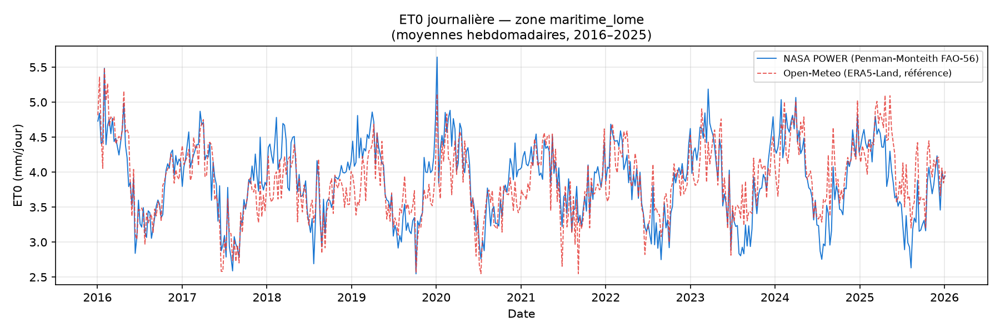
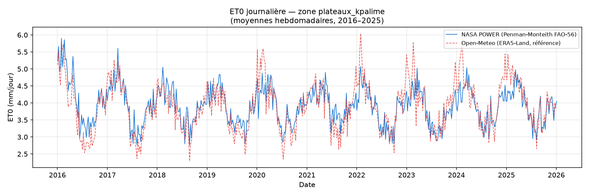
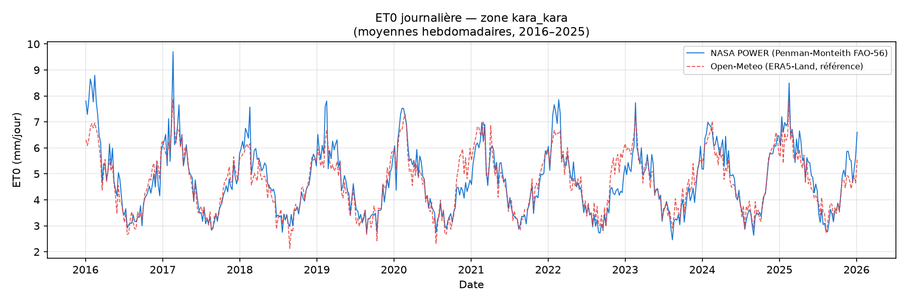

# Validation ET0 — NASA POWER vs Open-Meteo

> **Date de génération** : 2026-11-15  
> **Période analysée** : 2016-01-01 → 2025-12-31  
> **Source NASA POWER** : `source_type: nasa_power` — réanalyse NASA, ET0 recalculée par Penman-Monteith FAO-56 (notre pipeline `pipeline/et0.py`)  
> **Source Open-Meteo** : `source_type: public_historical_reanalysis` — ET0 FAO fournie par l'API Open-Meteo Historical (ERA5-Land/Best Match)  
> **Avertissement** : cette comparaison porte sur deux modèles de réanalyse à des mailles différentes. Ce n'est **pas** une mesure de terrain.

---

## Métriques globales par zone

| Zone | ET0 POWER (mm/an) | ET0 Open-Meteo (mm/an) | Biais (mm/j) | Écart rel. (%) | Corrélation r | Jours communs |
|---|---|---|---|---|---|---|
| Maritime – Lomé | 1417 | 1414 | 0.008 | 0.2 | 0.7358 | 3653 |
| Plateaux – Kpalimé | 1432 | 1424 | 0.022 | 0.6 | 0.7740 | 3653 |
| Kara – Kara | 1740 | 1718 | 0.058 | 1.2 | 0.8756 | 3653 |

## Jours manquants

| Zone | Manquants POWER | Manquants Open-Meteo |
|---|---|---|
| Maritime – Lomé | 0 | 0 |
| Plateaux – Kpalimé | 0 | 0 |
| Kara – Kara | 0 | 0 |

## Métriques mensuelles (biais moyen mm/jour)

### Maritime – Lomé

| Mois | ET0 POWER (mm/j) | ET0 Open-Meteo (mm/j) | Biais (mm/j) | Écart rel. (%) | r | N jours |
|---|---|---|---|---|---|---|
| Jan | 4.39 | 4.09 | 0.306 | 7.5 | 0.6704 | 310 |
| Fév | 4.44 | 4.31 | 0.126 | 2.9 | 0.4589 | 283 |
| Mar | 4.51 | 4.37 | 0.142 | 3.3 | 0.5254 | 310 |
| Avr | 4.30 | 4.38 | -0.080 | -1.8 | 0.6564 | 300 |
| Mai | 3.94 | 4.05 | -0.109 | -2.7 | 0.6615 | 310 |
| Jun | 3.43 | 3.36 | 0.073 | 2.2 | 0.7196 | 300 |
| Jul | 3.15 | 3.41 | -0.255 | -7.5 | 0.6307 | 310 |
| Aoû | 3.23 | 3.47 | -0.236 | -6.8 | 0.5637 | 310 |
| Sep | 3.39 | 3.52 | -0.125 | -3.6 | 0.6770 | 300 |
| Oct | 3.63 | 3.73 | -0.094 | -2.5 | 0.7770 | 310 |
| Nov | 4.03 | 3.88 | 0.157 | 4.1 | 0.6720 | 300 |
| Déc | 4.13 | 3.94 | 0.195 | 5.0 | 0.6125 | 310 |

> **Plus grand biais** : 0.306 mm/j en Jan.

### Plateaux – Kpalimé

| Mois | ET0 POWER (mm/j) | ET0 Open-Meteo (mm/j) | Biais (mm/j) | Écart rel. (%) | r | N jours |
|---|---|---|---|---|---|---|
| Jan | 4.38 | 4.74 | -0.363 | -7.7 | 0.5918 | 310 |
| Fév | 4.51 | 4.85 | -0.348 | -7.2 | 0.4607 | 283 |
| Mar | 4.57 | 4.36 | 0.219 | 5.0 | 0.6059 | 310 |
| Avr | 4.40 | 4.25 | 0.150 | 3.5 | 0.6467 | 300 |
| Mai | 4.06 | 3.96 | 0.101 | 2.6 | 0.7480 | 310 |
| Jun | 3.48 | 3.31 | 0.176 | 5.3 | 0.7443 | 300 |
| Jul | 3.28 | 3.12 | 0.159 | 5.1 | 0.6271 | 310 |
| Aoû | 3.37 | 3.16 | 0.207 | 6.5 | 0.6413 | 310 |
| Sep | 3.36 | 3.18 | 0.177 | 5.6 | 0.7152 | 300 |
| Oct | 3.69 | 3.59 | 0.094 | 2.6 | 0.7903 | 310 |
| Nov | 3.96 | 4.03 | -0.061 | -1.5 | 0.7146 | 300 |
| Déc | 4.03 | 4.30 | -0.273 | -6.3 | 0.6421 | 310 |

> **Plus grand biais** : -0.363 mm/j en Jan.

### Kara – Kara

| Mois | ET0 POWER (mm/j) | ET0 Open-Meteo (mm/j) | Biais (mm/j) | Écart rel. (%) | r | N jours |
|---|---|---|---|---|---|---|
| Jan | 6.33 | 6.04 | 0.295 | 4.9 | 0.7327 | 310 |
| Fév | 6.86 | 6.51 | 0.345 | 5.3 | 0.7546 | 283 |
| Mar | 5.87 | 5.51 | 0.356 | 6.5 | 0.7090 | 310 |
| Avr | 5.47 | 5.22 | 0.244 | 4.7 | 0.7137 | 300 |
| Mai | 4.89 | 4.59 | 0.298 | 6.5 | 0.7249 | 310 |
| Jun | 4.05 | 3.92 | 0.134 | 3.4 | 0.7194 | 300 |
| Jul | 3.36 | 3.37 | -0.015 | -0.4 | 0.6991 | 310 |
| Aoû | 3.17 | 3.24 | -0.076 | -2.4 | 0.7365 | 310 |
| Sep | 3.39 | 3.45 | -0.061 | -1.8 | 0.7180 | 300 |
| Oct | 3.98 | 4.16 | -0.177 | -4.3 | 0.8165 | 310 |
| Nov | 4.66 | 5.04 | -0.383 | -7.6 | 0.5333 | 300 |
| Déc | 5.27 | 5.52 | -0.253 | -4.6 | 0.5834 | 310 |

> **Plus grand biais** : -0.383 mm/j en Nov.

## Graphiques

## Interprétation

### Origine des écarts

Les deux sources produisent une ET0 de référence FAO-56, mais à partir de données et de mailles différentes :

| Critère | NASA POWER | Open-Meteo (ERA5-Land) |
|---|---|---|
| Modèle climatique | GEOS-5 (NASA GMAO) | ERA5-Land (ECMWF) |
| Résolution spatiale | ~50 km | ~9 km (ERA5-Land rétropolé) |
| Méthode ET0 | Penman-Monteith FAO-56 **recalculée** par notre pipeline | Penman-Monteith FAO-56 **calculée** par Open-Meteo |
| Variables d'entrée | T2M, RH2M, WS2M, ALLSKY_SFC_SW_DWN, altitude POWER | Températures, humidité, vent, rayonnement ERA5 |
| Rayonnement solaire | ALLSKY_SFC_SW_DWN (toutes conditions de ciel) | Rayonnement ERA5-Land |

Les différences de biais entre zones reflètent probablement :
- des écarts de représentation du rayonnement solaire (principale source de variabilité de l'ET0 en Afrique de l'Ouest) ;
- des différences d'humidité relative et de vent entre les deux réanalyses ;
- la résolution : NASA POWER à 50 km lisse les gradients locaux (orographie des Plateaux, brise de mer à Lomé).

### Limites

- Notre simplification FAO-56 utilise RH2M (moyenne journalière) au lieu de RHmax/RHmin (D-12 dans `DECISIONS.md`), ce qui peut sous-estimer légèrement la demande évaporative.
- Open-Meteo arrondit certaines valeurs à la journée ; NASA POWER est une intégration journalière.
- Cette comparaison ne valide pas le moteur de bilan hydrique, qui utilise nos normales décadaires 1991-2020, pas les valeurs journalières.

**Ce résultat est une comparaison de deux réanalyses, pas une validation sur données de terrain.**
Les deux sources portent `source_type: nasa_power` et `public_historical_reanalysis` respectivement.
